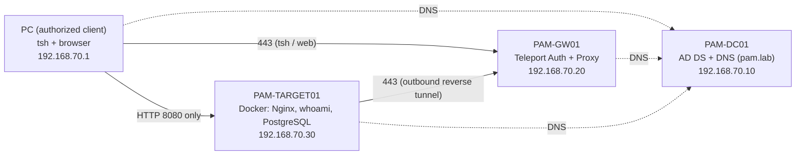

# Privileged Access Management (PAM) Lab with Teleport

[]()
[]()
[]()

A hands-on lab that puts **all administrator access to a Linux server behind a PAM gateway**, enforces **least privilege** with role-based access control and MFA, and **closes the direct SSH path** with layered firewalls, while keeping a full audit trail.

Academic project at TEK-UP (Cybersecurity, 5-SSIR-A, 2026-2027), by Ayachi Yassine and Elheni Cyrine.
**Status: in progress.** Everything marked "done" below was run and observed in the lab; open items are listed honestly at the end.

## Why this project

A shared or permanent admin account is a single point of compromise. The goal is to show, with evidence, that:

1. admins reach servers only through a gateway that issues **short-lived certificates** (2 to 8 h) after password + TOTP MFA;
2. each role can do **only** what it needs (and the denials are tested, not assumed);
3. a user who tries to bypass the gateway by connecting **directly** is blocked at the network level;
4. every session is **audited and recorded**.

## Architecture



Network: VMware Host-only `192.168.70.0/24`. Direct SSH to TARGET01 is blocked; the only way in is Teleport, because the target's agent dials **out** to the Proxy. See [docs/architecture.md](docs/architecture.md).

| Machine | Role | Stack |
|---|---|---|
| PAM-GW01 | PAM gateway | Ubuntu 24.04, Teleport Community Edition 18.11.3, ufw |
| PAM-TARGET01 | Protected host | Ubuntu 24.04, Docker, Nginx + whoami + PostgreSQL 16, ufw + `DOCKER-USER` |
| PAM-DC01 | Identity/DNS | Windows Server 2022, AD DS + DNS (`pam.lab`) |
| PC | Authorized client | Windows 11, `tsh` |

## Roles (least privilege, tested)

| Role | Linux account | Cert. validity | Can | Cannot |
|---|---|---|---|---|
| `infra-admin` | `sysadmin` | 8 h | SSH via Teleport, `sudo`, `docker` | administer Teleport |
| `app-operator` | `appop` | 2 h | SSH as `appop`, unprivileged commands | `sudo`, `docker`, log in as `sysadmin` |
| `limited-user` | none | 2 h | authenticate | open a session anywhere |
| `pam-admin` | none | n/a | administer Teleport, read audit/recordings | SSH to any resource |

Details: [docs/rbac.md](docs/rbac.md).

## Results so far

- **8 authorization tests (A1-A8): all matched the expected outcome**, including denied `sudo`, denied `docker`, denied cross-account login, and a user with no logins.
- **9 firewall tests (F1-F9): all passed.** New direct SSH times out, `tsh ssh` keeps working, Nginx answers only to the authorized client, PostgreSQL is never exposed.
- **Audit verified:** failed logins, denied attempts, session start/end and a replayable session recording appear in Teleport's audit log.

Full tables and observations: [docs/test-results.md](docs/test-results.md). Raw evidence log: [docs/evidence-log.md](docs/evidence-log.md).

### Notable technical detail

Docker-published ports **bypass ufw's INPUT rules**. Restricting Nginx therefore needs rules in Docker's `DOCKER-USER` chain, made persistent with a small systemd unit ([configs/firewall](configs/firewall)). A 15-minute rollback timer was used as a safety net while applying firewall changes.

## Repository layout

```
configs/
  teleport/roles.yaml            Teleport roles
  docker/                        Compose file, Nginx config, .env.example
  firewall/                      ufw scripts + DOCKER-USER systemd unit
docs/
  architecture.md  rbac.md  test-results.md  limitations-and-roadmap.md  evidence-log.md
report/
  rapport-pam.pdf / .tex         Full technical report (French)
```

## Reproducing (outline)

1. Create the Host-only network and the three VMs; assign the addresses above.
2. DC-01: promote to domain controller `pam.lab`; add a DNS A record for `pam-gw01.pam.lab`.
3. GW01: install Teleport from the official apt repository, create a lab CA and a server certificate for `pam-gw01.pam.lab`, run `teleport configure`, enable local auth with TOTP.
4. TARGET01: `docker compose up -d` with [configs/docker](configs/docker); enroll the host with a short-lived join token; create the `sysadmin` and `appop` Linux users.
5. GW01: `tctl create -f configs/teleport/roles.yaml`; create users and enroll their MFA.
6. Apply the firewall configs, then re-run the tests in [docs/test-results.md](docs/test-results.md).

## Known limitations (honest scope)

- Active Directory provides **DNS and the domain only**. Teleport Community Edition supports GitHub as its only external SSO, so users are local to Teleport (AD/OIDC/SAML SSO is an Enterprise feature). AD-to-role mapping would be manual.
- `sysadmin` has passwordless sudo: control relies on role assignment, short certificates and audit.
- The firewall tests ran from the gateway and the PC, not yet from an attacker machine.

## Roadmap

- [ ] Prove firewall persistence across a TARGET01 reboot
- [ ] Wazuh: agents, log collection, detection rules (failed logins, denied access)
- [ ] Bypass and port-scan tests from Kali (T13-T16)
- [ ] Windows Defender Firewall rules, outbound filtering, firewall logging
- [ ] Access revocation and expiry tests
- [ ] Remove temporary NAT adapters and the admin SSH path on the gateway

See [docs/limitations-and-roadmap.md](docs/limitations-and-roadmap.md).

## Security notes

No secrets are committed: `.env`, certificates and keys are git-ignored, and the compose file reads the database password from an untracked `.env`. This is a **lab**; addresses are private and credentials are test-only.

Teleport Community Edition is used under its licence (free for individuals and companies under 100 employees and under $10M revenue); this repository contains only our own configuration and documentation.
