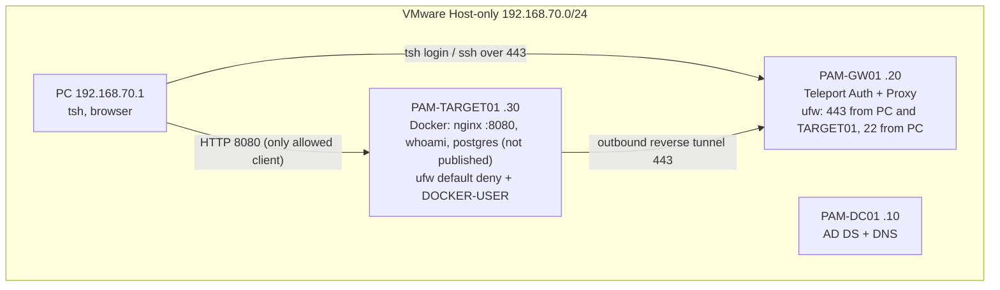

# Architecture

## Components and flows

| Flow | Port | Allowed | Why |
|---|---|---|---|
| PC to GW01 | 443 | yes | `tsh login`, `tsh ssh`, web UI |
| TARGET01 to GW01 | 443 | yes | agent reverse tunnel (outbound) |
| PC to TARGET01 | 8080 | yes | Nginx test app |
| PC to TARGET01 | 22 | **no** (timeout) | forces the PAM path |
| GW01 to TARGET01 | 22 / 8080 / 5432 | **no** | gateway is not a bypass route |
| anyone to PostgreSQL | 5432 | **no** | not published, internal Docker network |
| all to DC-01 | 53 | yes | agent resolves `pam-gw01.pam.lab` |

## Design decisions

- **Teleport and the protected resource are separate VMs**, so compromising the target does not give control of the gateway.
- **Reverse tunnel**: the target needs no inbound management port at all.
- **Two certificate authorities**: a lab OpenSSL CA for the Proxy's TLS certificate, and Teleport's internal CA for short-lived user and host certificates.
- **Firewall in two layers**: ufw for host services, `DOCKER-USER` for Docker-published ports (which bypass ufw INPUT).
- **AD limited to DNS/domain**: Teleport CE has no AD SSO; users are local with TOTP MFA.
- **Dependency worth knowing**: the agent connects by name, so DNS (DC-01) must be up for the node to appear after a cold start.
